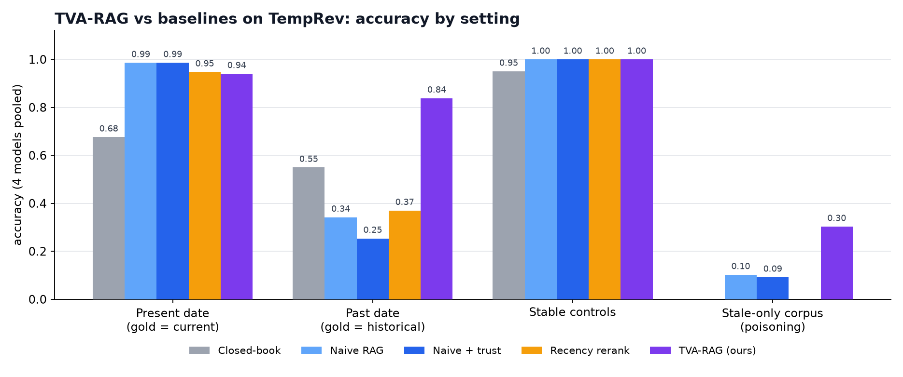
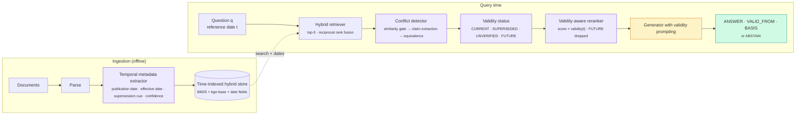
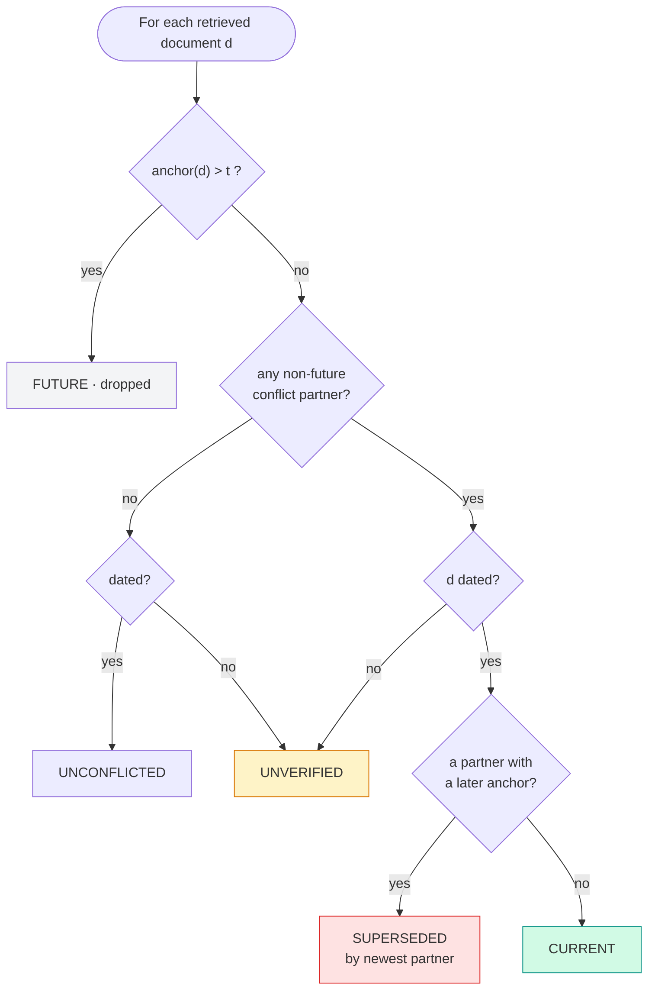
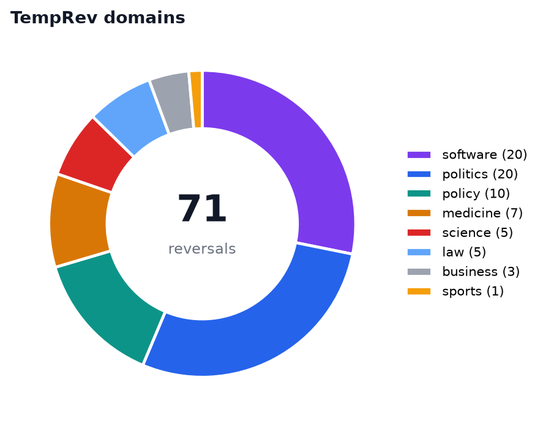
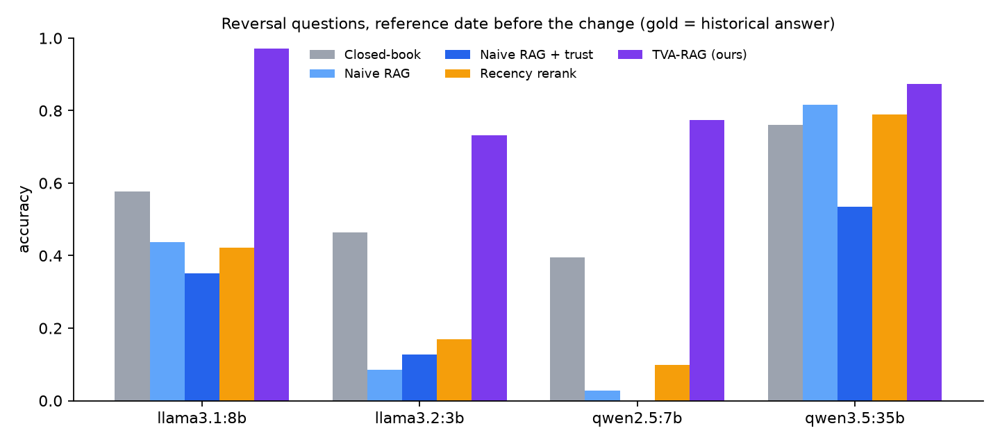
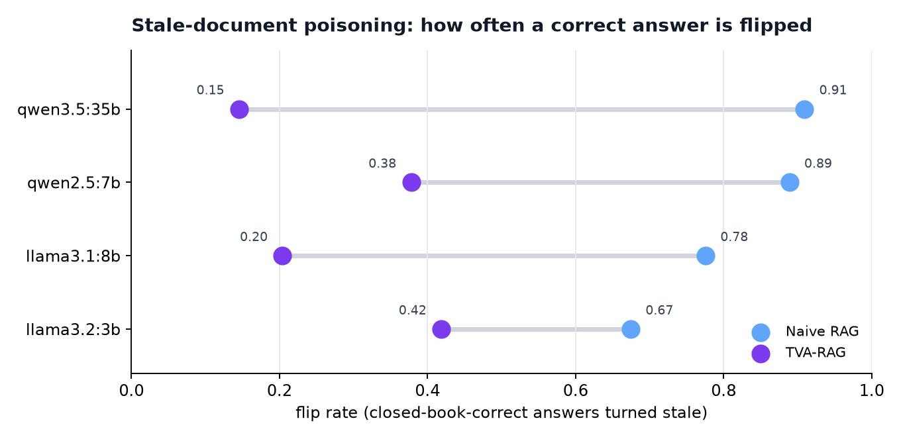
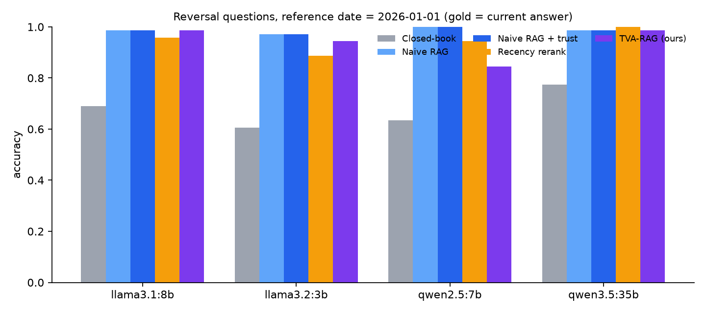
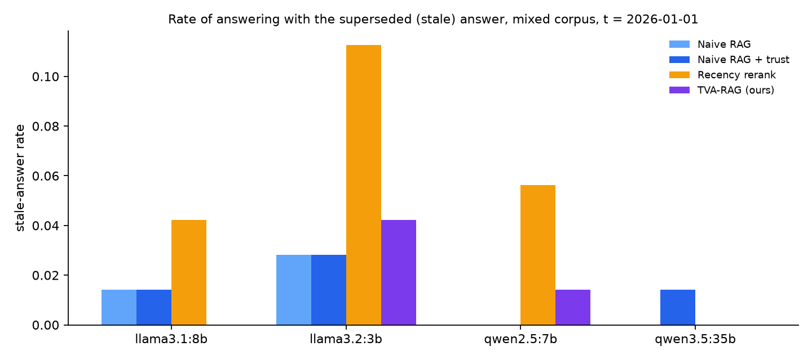
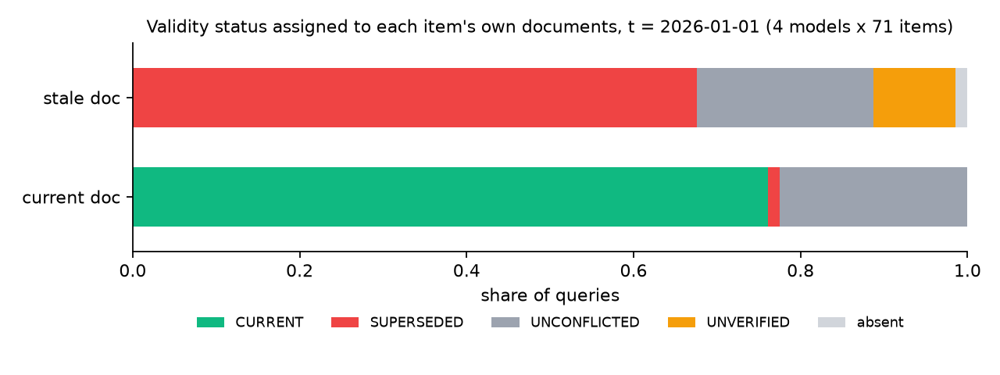

<div align="center">

# TVA-RAG
### Temporal-Validity-Aware Retrieval-Augmented Generation

**RAG that knows when its evidence expired.**
Detects superseded documents, answers *as of* any date, reports the validity window, and abstains when it cannot tell.

[](#quick-start)
[-000000)](https://ollama.com)
[](#models)
[](#the-temprev-benchmark)
[](#results)
[](report/TVA_RAG_Final_Report.pdf)



</div>

---

## The problem in one picture

A knowledge base is rarely cleaned. A 2024 circular says health insurance attracts **18 % GST**; a September 2025 circular says it is **exempt**. The retriever returns both. Naive RAG follows whichever it likes.

<table>
<tr><th width="18%">Mode</th><th width="22%">Reference date</th><th>What llama3.1:8b answered</th></tr>
<tr><td>Naive RAG</td><td>2024-11-28</td><td>"…individual health insurance policies are <b>now exempt</b> from GST." <i>(wrong: the exemption was ten months in the future)</i></td></tr>
<tr><td><b>TVA-RAG</b></td><td>2024-11-28</td><td><code>ANSWER: 18%  ·  VALID_FROM: 2024-02-05  ·  BASIS: Document 1</code> <i>(correct: the 2025 document was marked FUTURE and dropped)</i></td></tr>
<tr><td><b>TVA-RAG</b></td><td>2026-01-01</td><td><code>ANSWER: Exempt  ·  VALID_FROM: 2025-09-22  ·  BASIS: Document 1</code> <i>(correct)</i></td></tr>
</table>

A September 2026 study ([Stale-Document Poisoning](https://arxiv.org/abs/2609.31342)) showed that an outdated document flips **30–37 %** of otherwise-correct LLM answers, and up to **75 %** when the model is told to trust the document. The paper's fix, a recency reranker, recovered only 4.6–10 points. Its key observation: models follow current evidence almost perfectly, and switch almost perfectly **when told when the old evidence stopped applying**. TVA-RAG turns that observation into a system.

---

## Architecture



<details>
<summary><b>How each stage works</b> (click to expand)</summary>

| Stage | What it does |
|---|---|
| **Temporal metadata extractor** | Regex over seven header date styles and three effective-date styles (`Published: 24 August 2006`, `Date: 2006-08-24`, `w.e.f. 20.05.2019`, …). Anchor = effective date if present, else publication date. Confidence 0.95 / 0.8 / 0.5 by where the date was found; optional LLM fallback that is told not to infer dates from content. |
| **Hybrid retriever** | BM25 + `BAAI/bge-base-en-v1.5`, fused with reciprocal rank fusion (k = 60), top-5. |
| **Conflict detector** | Question-conditioned: a detector LLM (`qwen3.5:35b`) states the shortest answer each document gives to *this exact question* (or `NONE` after a scope check); two documents conflict when their claims are not equivalent. Cheap similarity gate first; every call cached and shared across generator models. |
| **Validity status** | Assigned **pairwise** relative to *t*: `FUTURE` (anchor > t, dropped) · `SUPERSEDED` (a conflicting document is dated later) · `CURRENT` · `UNVERIFIED` (no date) · `UNCONFLICTED`. |
| **Reranker** | `final = retrieval × validity(t) × trust`. Superseded documents sink but stay visible so the model can explain history. |
| **Validity prompting** | `[Document 2 \| dated: 2024-02-05 \| status: SUPERSEDED on 2025-09-22 by Document 1]` plus rules: prefer CURRENT, never return a SUPERSEDED answer as current, abstain only when the only relevant evidence is DATE UNKNOWN and conflicting. |

</details>



---

## The TempRev benchmark

The poisoning paper's dataset is not public, so this project ships its own: **71 real-world knowledge reversals** (each with a dated *stale* document and a dated *current* document) plus **20 stable control facts**.

<table>
<tr>
<td width="46%"></td>
<td>

| | |
|---|---|
| Reversal items | **71** (change dates 2006 → Sep 2025) |
| Documents | **162** (71 stale · 71 current · 20 control) |
| Header date formats | 7 (+ 3 effective-date formats) |
| Undated stale documents | 7 (abstention test) |
| Reference dates per item | 2 — **present** (gold = current answer) and **past** (gold = historical answer) |
| Corpus settings | **mixed** (both docs) · **stale-only** (current doc removed = poisoning) |

Examples: Python 2 end of life · GitHub `master`→`main` · IPC → Bharatiya Nyaya Sanhita · GST on health insurance 18 % → nil · Pluto · kilogram redefinition · COVID-19 PHEIC · newest NATO member · Saturn's moons 146 → 274.

</td>
</tr>
</table>

> Note: items were authored from well-documented public facts but are not independently audited. Verify before citing as ground truth.

---

## Results

Four open models, served locally with Ollama, temperature 0. **4,332 generations, zero failures.**

### 1 · Answering *as of* a past date — the decisive case

Every baseline is told the reference date. Naive RAG still answers with the **current** fact in 182 of its 187 errors. Retrieval makes small models *worse* than closed-book. TVA-RAG drops FUTURE documents and labels the rest.



| Model | Closed-book | Naive RAG | Naive + trust | Recency rerank | **TVA-RAG** |
|---|:-:|:-:|:-:|:-:|:-:|
| llama3.2:3b | 0.465 | 0.085 | 0.127 | 0.169 | **0.732** |
| llama3.1:8b | 0.577 | 0.437 | 0.352 | 0.423 | **0.972** |
| qwen2.5:7b | 0.394 | 0.028 | 0.000 | 0.099 | **0.775** |
| qwen3.5:35b | 0.761 | 0.817 | 0.535 | 0.789 | **0.873** |
| **Pooled** | 0.549 | 0.342 | 0.254 | 0.370 | **0.838** |

### 2 · Stale-document poisoning — only the stale document exists



| Model | Naive RAG flip | Naive + trust flip | **TVA-RAG flip** | TVA abstains | TVA still correct |
|---|:-:|:-:|:-:|:-:|:-:|
| llama3.2:3b | 0.674 | 0.698 | **0.419** | 0.070 | 0.512 |
| llama3.1:8b | 0.776 | 0.776 | **0.204** | 0.388 | 0.388 |
| qwen2.5:7b | 0.889 | 0.889 | **0.378** | 0.467 | 0.156 |
| qwen3.5:35b | 0.909 | 0.927 | **0.145** | 0.255 | 0.600 |

*Flip rate* = among questions the model answered correctly closed-book, the fraction turned into the stale answer by the stale document. TVA-RAG's age signalling converts most flips into abstentions or correct answers from the model's own knowledge.

### 3 · Present date with the current document available



| Model | Closed-book | Naive RAG | Naive + trust | Recency rerank | **TVA-RAG** (abstain) |
|---|:-:|:-:|:-:|:-:|:-:|
| llama3.2:3b | 0.606 | 0.972 | 0.972 | 0.887 | 0.944 (0.014) |
| llama3.1:8b | 0.690 | 0.986 | 0.986 | 0.958 | **0.986** (0.014) |
| qwen2.5:7b | 0.634 | 1.000 | 1.000 | 0.944 | 0.845 (0.141) |
| qwen3.5:35b | 0.775 | 0.986 | 0.986 | 1.000 | 0.986 (0.014) |
| **Pooled** | 0.676 | **0.986** | 0.986 | 0.947 | 0.940 (0.046) |

Modern instruction-tuned models already prefer the document that answers most directly, so naive RAG is near the ceiling here. TVA-RAG matches it for llama3.1:8b and qwen3.5:35b; the pooled gap is almost entirely qwen2.5:7b's over-abstention. The **recency reranker is worse than naive RAG** for three models: sorting by date alone surfaces recent documents about *other* topics first.



### 4 · What TVA-RAG adds that no baseline has

| | llama3.2:3b | llama3.1:8b | qwen2.5:7b | qwen3.5:35b |
|---|:-:|:-:|:-:|:-:|
| `VALID_FROM` stated | 1.000 | 0.986 | 0.915 | 0.986 |
| …within **31 days** of the true change date | 0.873 | 0.944 | 0.718 | 0.958 |
| …within 1 year | 0.901 | 0.958 | 0.775 | 0.972 |

**Control questions:** every retrieval mode scores **1.000** on the 20 stable facts for all four models — no regression.



---

## Component evaluation

| Component | Metric | Value |
|---|---|:-:|
| Temporal extractor (regex) | anchor-date accuracy, 162 docs, 7 header formats | **1.000** |
| Temporal extractor | reports "unknown" on the 7 undated docs | 1.000 |
| LLM date fallback | hallucinated a date on undated docs | 0 / 7 |
| Retrieval recall@5 of both item docs | BM25 / dense / **hybrid** | 0.944 / 1.000 / **0.986** |
| Conflict detector (deployed, full run) | pair precision / recall / F1 | **0.922** / 0.757 / 0.831 |
| Status assignment | item documents with correct status | 0.848 |

**Detector ablation** (on-topic retrieved pairs, 71 questions):

| Detector | Precision | Recall | F1 | Cost / query |
|---|:-:|:-:|:-:|:-:|
| **Claims · qwen3.5:35b** (used) | **0.898** | 0.757 | **0.822** | 1.7 s (cached after first run) |
| NLI cross-encoder, similarity-gated | 0.727 | **0.914** | 0.810 | 0.06 s |
| Claims · llama3.1:8b | 0.549 | 0.800 | 0.651 | 1.1 s |

Precision was chosen over recall on purpose: a false conflict can mark the *correct* document SUPERSEDED, whereas a missed conflict only degrades TVA-RAG to naive behaviour for that query. The NLI model on its own was unusable (median contradiction probability 0.99 on *unrelated* pairs, 0.003 on a real "screen at 50 vs 40" conflict); the 8B model judged `main` and `master` to be the same answer.

<details>
<summary><b>Error analysis highlights</b></summary>

- **Present date, TVA-RAG:** 4 non-abstaining errors out of 284. The 3B model occasionally follows its parametric prior over the CURRENT label; qwen2.5:7b once echoed the status word ("Croatian kuna (SUPERSEDED)").
- **qwen2.5:7b abstains on 10 / 71** present-date questions despite a CURRENT document, mostly software lifecycle yes/no questions. A deterministic post-check that overrides ABSTAIN when a CURRENT document carries a claim would remove most of these.
- **Past date, TVA-RAG:** 46 errors / 284. llama3.2:3b leaks the current fact from memory 15 times; 43 % of the 21 abstentions are the undated items where abstaining is the designed behaviour.
- **Naive RAG, past date:** 182 / 187 errors are the current fact — an evidence-selection failure, not a prompt-reading failure.
- **Recency reranker:** all 18 present-date errors are stale answers caused by date-only ordering.
</details>

---

## Quick start

```bash
git clone https://github.com/RakeshTirlangi/TVA-Rag.git && cd TVA-Rag
pip install -r requirements.txt
ollama pull llama3.2:3b llama3.1:8b qwen2.5:7b qwen3.5:35b      # any Ollama models work

python data/build_benchmark.py                                   # -> data/temprev.json
python scripts/run_experiments.py --models llama3.1:8b --settings mixed stale_only
python scripts/analyze.py --judge-model qwen3.5:35b              # -> results/metrics_*.csv + figures/
streamlit run app.py                                             # side-by-side demo: naive vs TVA-RAG
```

<details>
<summary><b>Use TVA-RAG on your own documents</b></summary>

```python
import sys, datetime as dt; sys.path.insert(0, "src")
from tva_rag.corpus import Document
from tva_rag.pipeline import TVARAG
from tva_rag.generator import get_client

docs = [Document(doc_id="n1", item="gst", role="old", title="GST on insurance premiums",
                 text="GST on insurance premiums\nPublished: 5 February 2024\n\nPremiums ... attract GST at 18 percent.",
                 true_date="2024-02-05", true_effective=None, undated=False),
        Document(doc_id="n2", item="gst", role="new", title="GST exemption on health insurance",
                 text="GST exemption on health insurance\nDate: 2025-09-22\n\nIndividual health insurance policies are now exempt from GST.",
                 true_date="2025-09-22", true_effective=None, undated=False)]

system = TVARAG(docs, get_client(), device="cuda", k=5)
out = system.answer("What GST rate applies to individual health insurance premiums?", dt.date(2024, 11, 28), "tva", "llama3.1:8b")
print(out["answer"], out["valid_from"], out["statuses"])
# -> 18%  2024-02-05  {'n1': 'CURRENT'}        (n2 was FUTURE and dropped)
```
</details>

---

## Repository layout

```
tva_rag/
├── data/
│   ├── build_benchmark.py        authors TempRev → temprev.json
│   └── temprev.json              71 reversals · 20 controls · 162 rendered documents
├── src/tva_rag/
│   ├── corpus.py                 benchmark loading, query construction (now / past / control)
│   ├── temporal.py               regex temporal extractor (+ optional LLM fallback)
│   ├── retriever.py              BM25 + bge-base, reciprocal rank fusion
│   ├── conflict.py               claims / NLI detectors, pairwise validity status
│   ├── reranker.py               validity-aware rerank · recency baseline
│   ├── generator.py              Ollama client (retry), prompt templates, parser
│   ├── judge.py                  alias match + cached LLM judge
│   └── pipeline.py               TVARAG: closed_book · naive · naive_trust · recency · tva
├── scripts/
│   ├── run_experiments.py        resumable grid runner → results/runs.jsonl
│   ├── analyze.py                labelling, metrics, figures
│   └── calibrate_conflict.py     detector precision / recall
├── results/                      runs.jsonl · labeled.csv · metrics_*.csv · figures/ · caches
└── app.py                        Streamlit demo
```

## Models

| Role | Model | Notes |
|---|---|---|
| Generators | `llama3.2:3b` · `llama3.1:8b` · `qwen2.5:7b` · `qwen3.5:35b` | temperature 0, seed fixed, thinking disabled |
| Conflict detector | `qwen3.5:35b` | claims + equivalence, cached per question |
| Answer judge | `qwen3.5:35b` | only for the 14 % of answers alias matching cannot settle |
| Embeddings | `BAAI/bge-base-en-v1.5` | dense retrieval and similarity gate |
| NLI (ablation) | `cross-encoder/nli-deberta-v3-base` | |

Hardware used: one NVIDIA RTX PRO 5000 (48 GB). Mean latency per query: naive 0.49 s · TVA-RAG 0.74 s (detector cached).

## Limitations

Team-authored benchmark (≈ ±10 pt confidence intervals per model) · regular document headers and explicit supersession sentences make extraction and detection easier than in the wild · single deterministic run · 14 % of labels from an LLM judge · 35B detector model · English, short documents, single-hop questions · fixed "present" of 2026-01-01.

## Reports

- [`TVA_RAG_Final_Report.pdf`](report/TVA_RAG_Final_Report.pdf) · [`.tex`](report/TVA_RAG_Final_Report.tex) (Overleaf-ready, self-contained TikZ + pgfplots) · [`.md`](report/TVA_RAG_Final_Report.md)
- Problem-statement survey that led to this project: [`RAG_Problem_Statements_Report.md`](report/RAG_Problem_Statements_Report.md)

## Key references

1. Stale-Document Poisoning: When Outdated Retrieval Overrides Correct Model Answers — arXiv:2609.31342 (2026)
2. ConflictRAG — arXiv:2605.17301 (2026) · EvoTrustRAG — arXiv:2608.07933 (2026) · ArbGraph — arXiv:2604.18362 (2026)
3. Retrieval-State Lock-In — arXiv:2606.22728 (2026) · Know Before You Fetch — arXiv:2606.29959 (2026) · TARG — arXiv:2511.09803 (2025)
