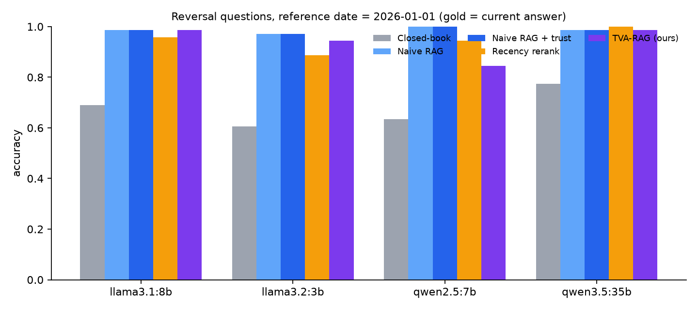
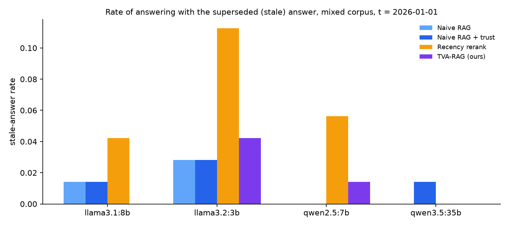
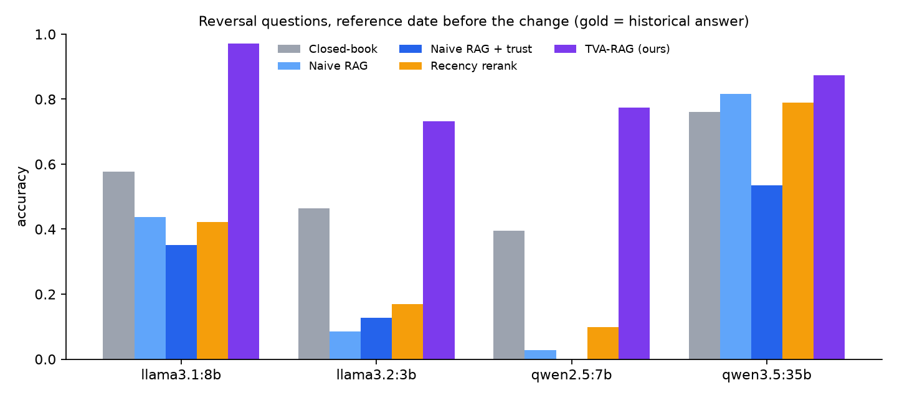
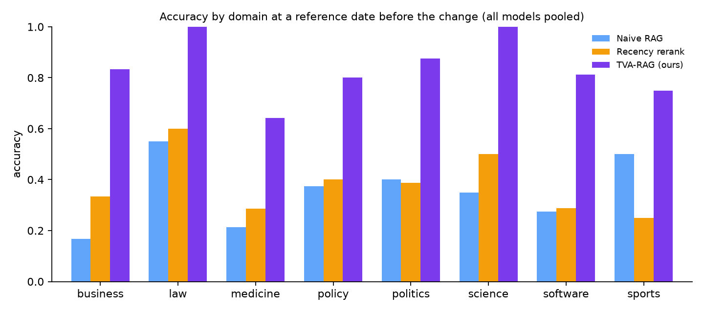
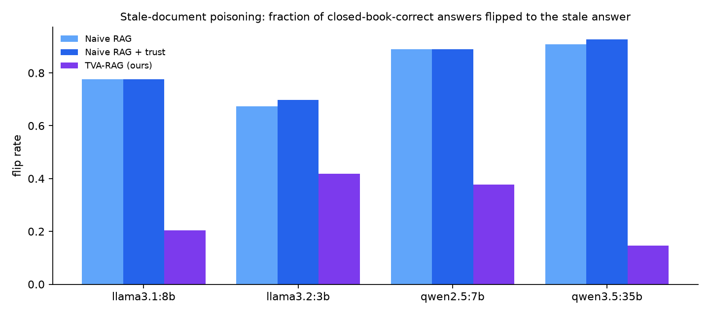
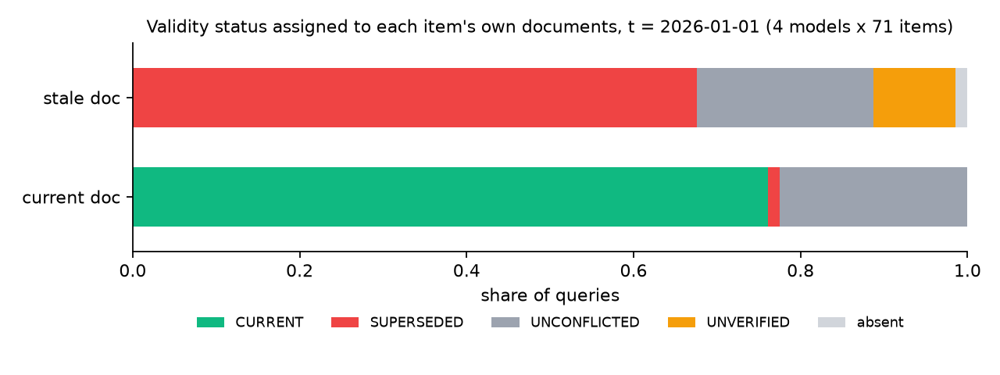

# Temporal-Validity-Aware Retrieval-Augmented Generation (TVA-RAG)
## Detecting Superseded Evidence and Answering "As Of" a Date in RAG Systems

**Major Project Final Report**
*Date: 6 November 2026*

---

## Abstract

Retrieval-Augmented Generation (RAG) is supposed to cure a language model's outdated knowledge, but it fails when the retrieved document is itself outdated. A September 2026 study of "stale-document poisoning" showed that an outdated document flips 30 to 37 percent of otherwise-correct answers of open models, and up to 75 percent when the model is told to trust the document. This project designs, implements and evaluates **TVA-RAG**, a Temporal-Validity-Aware RAG system that (a) extracts publication and effective dates at ingestion, (b) detects when two retrieved documents give different answers to the same question, (c) assigns each document a validity status (CURRENT, SUPERSEDED, UNVERIFIED, FUTURE) relative to a reference date, (d) reranks by validity and (e) tells the generator explicitly which evidence has expired, with an abstention path when dates cannot be verified.

Because the original study's dataset is not public, we built **TempRev**, a benchmark of 71 real-world knowledge reversals across science, software, Indian law and policy, world politics, medicine and business, each with a dated stale document and a dated current document, plus 20 stable control facts. Every reversal is queried at two reference dates: the present (gold = current answer) and a date before the change (gold = historical answer).

Across four open models served locally through Ollama (llama3.2:3b, llama3.1:8b, qwen2.5:7b, qwen3.5:35b), TVA-RAG matches naive RAG when the knowledge base contains the current document (0.94 vs 0.99 pooled accuracy at the present date), is the only system that reliably answers "as of" a past date (0.84 pooled accuracy vs 0.34 for naive RAG, 0.37 for a recency reranker and 0.55 closed-book), and, when only the stale document exists in the knowledge base, cuts the stale-document flip rate from 0.67 to 0.93 down to 0.15 to 0.42 while raising accuracy from 0.10 to 0.30 and converting most remaining failures into explicit abstentions. Control accuracy is unchanged at 1.00. The validity window TVA-RAG reports matches the true change date within 31 days in 72 to 96 percent of cases depending on the model.

---

## Table of Contents

1. [Introduction](#1-introduction)
2. [Problem Statement](#2-problem-statement)
3. [Related Work](#3-related-work)
4. [The TempRev Benchmark](#4-the-temprev-benchmark)
5. [System Architecture](#5-system-architecture)
6. [Implementation](#6-implementation)
7. [Experimental Setup](#7-experimental-setup)
8. [Results](#8-results)
9. [Component Evaluation and Ablations](#9-component-evaluation-and-ablations)
10. [Error Analysis](#10-error-analysis)
11. [Discussion](#11-discussion)
12. [Limitations](#12-limitations)
13. [Future Work](#13-future-work)
14. [Conclusion](#14-conclusion)
15. [References](#15-references)
16. [Appendix A: Prompts](#appendix-a-prompts)
17. [Appendix B: Reproduction](#appendix-b-reproduction)

---

## 1. Introduction

Large Language Models (LLMs) are trained on a frozen snapshot of text. RAG connects them to external documents at query time so that answers can reflect private, specialised or recently changed information. In practice, however, a knowledge base accumulates documents over years and is rarely cleaned. A 2015 notice saying that Python 2 is supported sits next to a 2020 notice saying it has reached end of life. A 2024 circular says health insurance attracts 18 percent GST; a September 2025 circular says it is exempt. A retriever that ranks by semantic similarity returns both, and a generator that is told to "use the documents" may follow either.

The 2026 stale-document poisoning study (Section 3) measured how damaging this is: models that answered correctly from their own knowledge switched to the wrong answer when handed an outdated document. The paper's own mitigation, a recency-aware reranker, reduced the effect by only 4.6 to 10 points. The authors observed that models followed up-to-date evidence almost perfectly, and switched almost perfectly when they were told *when* the old evidence stopped applying. That observation is the starting point of this project: the generator does not need better reading comprehension; it needs the system to tell it which evidence is still valid.

TVA-RAG makes temporal validity a first-class signal in the pipeline. The contributions of this project are:

1. **A benchmark (TempRev)** of 71 verified knowledge reversals with dated stale and current documents, a two-reference-date protocol, undated-document cases for abstention testing and 20 control facts.
2. **A complete TVA-RAG implementation** with a regex temporal extractor, hybrid BM25 plus dense retrieval, a question-conditioned claim-level conflict detector, pairwise validity status assignment, validity-aware reranking, validity prompting and abstention.
3. **A controlled evaluation** against closed-book, naive RAG, naive RAG with a trust instruction and the recency-reranker baseline, on four open models, in a mixed-corpus setting and a stale-only poisoning setting.
4. **Component-level evaluation and ablations** of the extractor, retriever and three conflict-detector variants, plus a prompt ablation and an error analysis.

---

## 2. Problem Statement

### 2.1 Informal statement

Given a knowledge base in which documents about the same fact were written at different times and may contradict each other, a RAG system should answer a question *as it was correctly answerable on a given reference date*, cite the evidence it used, state from when that answer holds, and refuse to answer confidently when it cannot establish whether its evidence is still valid.

### 2.2 Formal statement

Let *D* be a corpus of documents, each with an unknown or partially known publication date and possibly an effective date. Let *q* be a question and *t* a reference date. Design a system *S(q, t, D)* that returns an answer *a*, a set of cited documents *C*, a validity window *[v_from, v_to)* and an abstention flag such that:

- (a) **Temporal correctness:** *a* equals the answer that was true at time *t*.
- (b) **Supersession detection:** a document whose answer has been replaced by a later document dated at or before *t* is never used as the current answer.
- (c) **As-of reasoning:** documents dated after *t* are not used.
- (d) **Validity reporting:** *v_from* is the date from which *a* holds.
- (e) **Calibrated abstention:** when the only relevant evidence has an unknown date and conflicts with other evidence, the system abstains instead of guessing.
- (f) **No regression:** accuracy on questions whose answer never changed is unchanged.

The primary metrics are temporal accuracy at *t*, the stale-answer rate (answering with the superseded answer when *t* is after the change), the stale-document flip rate (fraction of closed-book-correct answers turned wrong by stale evidence), the abstention rate, validity-window agreement and control accuracy.

### 2.3 Scope

The project covers English-language short-answer factual questions with a single well-defined answer at any time, documents of notice or article length, and open-weight models that run locally. Multi-hop temporal reasoning, multilingual documents and long documents requiring chunking are out of scope (Section 13).

---

## 3. Related Work

**Stale-document poisoning.** The September 2026 arXiv study "Stale-Document Poisoning: When Outdated Retrieval Overrides Correct Model Answers" built 317 verified knowledge reversals in medicine, law, software and platform policy and tested 12 models. Outdated retrieval flipped 30 percent of Llama answers and 37 percent of Qwen answers without any trust instruction, and 66 to 75 percent with one. Matched up-to-date evidence was followed 97 to 100 percent of the time. Telling the model when the old evidence stopped applying almost completely restored correctness, while a fixed recency-aware hybrid reranker reduced poisoning by only 4.6 to 10 points. TVA-RAG operationalises the "validity signalling" finding as a system component and adds conflict detection, as-of filtering and abstention.

**Knowledge conflicts in RAG.** ConflictRAG (2026) detects, classifies (factual, temporal, opinion) and resolves inter-document conflicts. EvoTrustRAG (2026) builds a span-grounded conflict evidence graph and uses temporal relations to decide whether a conflict reflects legitimate knowledge evolution. ArbGraph (2026) arbitrates between claims before generation for long-form answers. DRAGged into Conflicts (2025) offers a taxonomy of inter-context conflicts and notes that earlier work mostly studied one conflict type at a time. These systems resolve contradictions but do not expose validity windows, filter future evidence for as-of queries, or abstain on undated evidence.

**Adaptive retrieval and abstention.** Retrieval-state lock-in (2026) shows that sampling-based confidence is blind to errors caused by a stable but wrong retrieval state. Know Before You Fetch (2026) and TARG (2025) gate retrieval on calibrated uncertainty. TVA-RAG's abstention is rule-based and evidence-driven rather than confidence-driven, and could be combined with these methods.

**Temporal question answering.** Benchmarks such as TimeQA, TempLAMA and SituatedQA study time-dependent questions for closed-book models. TempRev differs in supplying the conflicting documents themselves, so that the retrieval-side handling of stale evidence can be measured.

---

## 4. The TempRev Benchmark

### 4.1 Design

Each **reversal item** records a real-world fact that changed:

| Field | Description |
|---|---|
| question | A present-tense factual question, e.g. "What GST rate applies to individual health insurance premiums in India?" |
| old answer, aliases | The answer that was correct before the change, with surface variants for matching |
| new answer, aliases | The answer that became correct after the change |
| old document | Title, publication date and 40 to 90 word body written as a notice or article from before the change |
| new document | Title, publication date, optional effective date, body written at or after the change; most contain a supersession sentence |
| change date | The date from which the new answer holds |
| undated_old | If true, all date cues are stripped from the stale document (7 items) |
| t_past | Optional explicit historical reference date (used where an intermediate state existed) |

**Control items** (20) are stable facts with a single dated document, used to detect regressions.

### 4.2 Composition

| Domain | Items | Examples |
|---|---|---|
| Software and technology | 20 | Python 2 end of life, GitHub default branch, Java LTS, TLS 1.0/1.1 deprecation, Windows 10 end of support, iPhone connector |
| World politics and geography | 20 | UK monarch, newest NATO member, Türkiye, North Macedonia, Croatia's currency, US President, Pope |
| Indian policy | 10 | Default income tax regime, GST on online gaming, GST on health insurance, GST slab structure, Union Territories count, 5G launch, city renamings |
| Medicine and public health | 7 | COVID-19 PHEIC status, USPSTF aspirin, hypertension threshold, colorectal and breast screening ages, peanut introduction, mpox |
| Indian law | 5 | IPC to BNS, Evidence Act to BSA, Section 377, triple talaq, Article 370 |
| Science | 5 | Pluto, kilogram definition, named elements, tallest building, Saturn's moons |
| Business | 3 | Alphabet, Twitter ownership, Air India |
| Sports | 1 | IPL team count |
| **Total reversals** | **71** | change dates from 2006 to September 2025 |
| Controls | 20 | Speed of light, capital of Australia, HTTP 404, Git creator, Republic Day |

Documents: 162 (71 stale, 71 current, 20 control).

### 4.3 Rendering with varied date formats

Documents are rendered from structured fields so that the temporal extractor must handle realistic variety. The header date format is chosen deterministically per document from seven styles: `Published: 24 August 2006`, `Date: 2006-08-24`, `Last updated: August 2006` (month precision only), `Press release dated 24/08/2006`, `Notification dated 24th August, 2006`, `(Issued 24 Aug 2006)` and `August 24, 2006`. Effective dates use `Effective from: ...`, `With effect from dd-mm-yyyy` or `w.e.f. dd.mm.yyyy`. For `undated_old` items the header is omitted and the body contains no absolute dates.

### 4.4 Query protocol

Each reversal yields two queries: at **t = 2026-01-01** (gold = new answer) and at **t_past**, the midpoint between the stale document's date and the change date (gold = old answer). The fixed present date keeps the benchmark reproducible and avoids facts that changed after the authoring date. Controls are queried at t = 2026-01-01.

### 4.5 Two corpus settings

- **Mixed:** the knowledge base contains all 162 documents. This is the realistic "never cleaned" knowledge base.
- **Stale-only:** the 71 current documents are removed. This replicates the stale-document poisoning condition, where the only evidence on the topic is outdated.

### 4.6 Caveats

The benchmark was authored by the project team from well-documented public facts and dates; each item should be independently verified before being cited as ground truth. Documents are short and most current documents contain an explicit supersession sentence, which makes conflict detection easier than in arbitrary web text (Section 12).

---

## 5. System Architecture

### 5.1 Overview

```
INGESTION (offline)
  Documents ──► Parse ──► Temporal Metadata Extractor ──► Time-indexed hybrid store
                           (pub. date, effective date,       (BM25 + dense + date fields)
                            supersession cue, confidence)

QUERY TIME (online)                 question q, reference date t
  Hybrid retriever (top-5, RRF)
        │
        ▼
  Conflict detector  ── similarity gate ── claim extraction per document (LLM)
        │                                  ── claim equivalence check (LLM)
        ▼
  Validity status assignment (pairwise, relative to t)
        CURRENT | SUPERSEDED (by, on) | UNVERIFIED | FUTURE | UNCONFLICTED
        │
        ▼
  Validity-aware reranker   score = retrieval × validity(t) ; FUTURE dropped
        │
        ▼
  Generator with validity prompting
        [Document i | dated d | status ...]  + rules + reference date
        │
        ▼
  ANSWER / VALID_FROM / BASIS   or   ABSTAIN
```

### 5.2 Temporal metadata extractor

A regex extractor recognises ISO dates, day-month-year and month-day-year forms with ordinal suffixes, numeric `dd/mm/yyyy`, `dd-mm-yyyy` and `dd.mm.yyyy`, and month-year forms (month precision). The **publication date** is the first date in the first three lines (confidence 0.95 for day precision, 0.8 for month precision), else the first date in the body (0.5). The **effective date** is a date within 40 characters after a cue such as *effective from*, *with effect from*, *w.e.f.*, *comes into force* or *applicable from*. A **supersession cue** flag is set by words such as *supersedes*, *replaces*, *no longer*, *repeal*, *retired*, *renamed*. The **anchor** used for validity reasoning is the effective date if present, else the publication date. An optional LLM fallback is invoked only when no date is found; it is instructed not to infer dates from historical content.

### 5.3 Hybrid retriever

BM25 (rank_bm25) over lowercased tokens and dense retrieval with BAAI/bge-base-en-v1.5 (query instruction prefix, normalised embeddings) are fused with reciprocal rank fusion (k = 60). Top-5 documents are passed on.

### 5.4 Conflict detector (question-conditioned claims)

1. **Similarity gate.** Only documents whose whole-text embedding similarity to at least one other retrieved document is at least 0.60 are candidates. On TempRev, no true conflicting pair has similarity below 0.70, so the gate loses nothing and skips obviously unrelated pairs.
2. **Claim extraction.** For each candidate, a detector LLM (qwen3.5:35b) is asked: *what answer does this document give to this exact question?* It must first check scope (same item, rule, entity, office or product) and reply with the shortest possible answer or `NONE`.
3. **Equivalence.** Two documents with non-`NONE` claims conflict when their normalised claims are not identical and the detector LLM judges them to be different answers (different names or spellings, entities, numbers, versions, dates, or opposite yes/no).

All detector calls are cached, so detection cost is paid once per (question, retrieved set), not per generator model.

An NLI variant (cross-encoder/nli-deberta-v3-base on the query-relevant sentence of each document, gated by document similarity 0.72 and a supersession cue rule) is kept as an ablation (Section 9.3).

### 5.5 Validity status assignment

Status is assigned **pairwise**, not through transitive clusters, so that a false conflict with one unrelated document cannot drag an unrelated chain of documents into a cluster:

| Status | Condition | Validity weight |
|---|---|---|
| FUTURE | anchor date > t | 0 (dropped before generation) |
| SUPERSEDED | conflicts with a non-future document whose anchor is later | 0.25; records *superseded_by* and *superseded_on* |
| CURRENT | conflicts with others and none is later | 1.0 |
| UNVERIFIED | no date could be established | 0.6 (0.4 if it conflicts with dated documents) |
| UNCONFLICTED | dated, no conflicts | 1.0 |

Dropping FUTURE documents is what makes "as-of" answers possible: at a past reference date the current document is simply not shown.

### 5.6 Validity-aware reranker

`final_score = retrieval_score × validity × source_trust` (source trust defaults to 1). Superseded documents stay in the context but sink below current ones; this keeps them available for the model to explain the history.

### 5.7 Validity prompting and abstention

Each document is presented as `[Document i | dated: d | status: CURRENT as of t / SUPERSEDED on d' by Document j / DATE UNKNOWN - cannot verify / no conflicting evidence found]`. The instruction states the reference date, explains the statuses, says to prefer CURRENT evidence and never return a SUPERSEDED answer as current, says not to abstain when a CURRENT document answers the question, and says to answer ABSTAIN only when no CURRENT document answers and the only relevant evidence is DATE UNKNOWN and conflicting. The output format is `ANSWER:`, `VALID_FROM:` and `BASIS:` lines.

In the stale-only setting a separate instruction is used, since no newer document exists to supersede anything: the document's age at the reference date is stated, and the model is told not to assume a time-varying fact is still valid, to use its own knowledge of later developments if confident, and otherwise to ABSTAIN.

### 5.8 Baselines

| Mode | Description |
|---|---|
| closed_book | No retrieval; reference date given |
| naive | Hybrid top-5, raw documents (dates visible in the text), reference date given |
| naive_trust | naive plus "your answer must follow the information in the documents" (the poisoning paper's trust condition) |
| recency | Top-5 ordered newest first by extracted anchor date; no status annotation (the poisoning paper's reranker baseline) |
| tva | Full TVA-RAG |

All baselines receive the reference date, so the as-of comparison is fair.

---

## 6. Implementation

```
tva_rag/
  data/build_benchmark.py      authors TempRev -> data/temprev.json (71 reversals, 20 controls, 162 docs)
  src/tva_rag/
    corpus.py                  benchmark loading, query construction (t_now, t_past, controls)
    temporal.py                regex temporal extractor (+ optional LLM fallback)
    retriever.py               BM25 + bge-base dense retrieval, reciprocal rank fusion
    conflict.py                claims / NLI conflict detectors, pairwise status assignment
    reranker.py                validity-aware rerank; recency baseline
    generator.py               Ollama client with retry, prompt templates, output parser
    judge.py                   answer labelling: alias match + LLM judge (cached)
    pipeline.py                TVARAG class with the five modes
  scripts/run_experiments.py   grid runner, resumable, JSONL output
  scripts/analyze.py           labelling, metrics, figures
  scripts/calibrate_conflict.py detector precision/recall on retrieved pairs
  app.py                       Streamlit demo (naive vs TVA side by side)
  results/                     runs.jsonl, labeled.csv, metrics_*.csv, figures/
```

**Stack.** Python 3.14, PyTorch 2.14 with CUDA, sentence-transformers 6.2, rank_bm25, pandas, matplotlib, Ollama 0.31 (llama-server backend). Hardware: one NVIDIA RTX PRO 5000 Blackwell (48 GB), 123 GB RAM.

**Models.** Generators: llama3.2:3b, llama3.1:8b, qwen2.5:7b, qwen3.5:35b (thinking disabled). Detector: qwen3.5:35b. Judge: qwen3.5:35b. Embeddings: BAAI/bge-base-en-v1.5. NLI ablation: cross-encoder/nli-deberta-v3-base. All generation uses temperature 0, fixed seed, 6,144-token context, at most 220 output tokens.

**Robustness.** The Ollama client retries with back-off (the llama-server backend crashed once during a cold load while PyTorch held GPU memory); the experiment runner is resumable by record key; every detector and judge call is cached on disk.

---

## 7. Experimental Setup

**Grid.** Mixed setting: 5 modes × 162 queries (71 now, 71 past, 20 control) × 4 models = 3,240 generations. Stale-only setting: 3 modes (naive, naive_trust, tva) × 91 queries × 4 models = 1,092 generations. Total 4,332 generations, zero failures.

**Labelling.** Each answer is labelled NEW, OLD, BOTH, OTHER or ABSTAIN. Alias matching handles 85.8 percent of answers (yes/no aliases are matched only at the start of the answer; short aliases as whole words). Ambiguous, unmatched and negated answers (14.2 percent) are sent to an LLM judge (qwen3.5:35b) shown the question, the old and new reference answers and the candidate, with decisions cached.

**Metrics.**
- *Accuracy at t:* label equals gold (NEW at t_now, OLD at t_past, CTL for controls).
- *Stale-answer rate:* label OLD when gold is NEW.
- *Flip rate:* among reversal items that the same model answered correctly closed-book at t_now, the fraction answered OLD under a RAG mode (the poisoning paper's metric); *flip_any* counts any non-abstaining wrong answer.
- *Abstention rate.*
- *Validity window:* for TVA at t_now, whether `VALID_FROM` is stated, and whether it is within 31 days or within a year of the true change date.
- *Component metrics:* extractor anchor-date accuracy, retrieval recall@5 of the item's documents, conflict-detector pair precision and recall on on-topic pairs (same-item pairs retrieved for a different question are excluded from both numerator and denominator), and item-document status correctness.

**Prompt refinement.** A pilot run of all modes revealed that qwen2.5:7b abstained in 15.5 percent of present-date queries even when a CURRENT document was available, and that the small Llama model sometimes wrote the status word `CURRENT` as its answer. The TVA instruction was clarified (do not abstain when a CURRENT document answers; the ANSWER line must contain the answer itself) and TVA mode was rerun for all models. Both versions are reported (Section 9.4). Baseline runs were not changed.

---

## 8. Results

### 8.1 Mixed corpus, present reference date (gold = current answer)

Accuracy (stale-answer rate / abstention in brackets where non-zero):

| Model | Closed-book | Naive RAG | Naive + trust | Recency rerank | **TVA-RAG** |
|---|---|---|---|---|---|
| llama3.2:3b | 0.606 (0.155) | 0.972 (0.028) | 0.972 (0.028) | 0.887 (0.113) | 0.944 (0.042 / abst 0.014) |
| llama3.1:8b | 0.690 (0.239) | 0.986 (0.014) | 0.986 (0.014) | 0.958 (0.042) | **0.986** (0.000 / abst 0.014) |
| qwen2.5:7b | 0.634 (0.211) | 1.000 | 1.000 | 0.944 (0.056) | 0.845 (0.014 / abst 0.141) |
| qwen3.5:35b | 0.775 (0.197) | 0.986 | 0.986 (0.014) | 1.000 | 0.986 (0.000 / abst 0.014) |
| **Pooled** | 0.676 (0.201) | **0.986** (0.011) | 0.986 (0.014) | 0.947 (0.053) | 0.940 (0.014 / abst 0.046) |



When the current document is in the knowledge base, naive RAG already performs near the ceiling: all four models prefer the document that answers the question most directly, and most current documents contain a supersession sentence. TVA-RAG matches naive RAG for llama3.1:8b and qwen3.5:35b. Its pooled gap of 4.6 points is almost entirely qwen2.5:7b's abstentions (10 of 71 queries, all with a CURRENT document present; Section 10). TVA-RAG has the lowest stale-answer rate of the retrieval modes for three of four models. The recency reranker, which orders by date only, is *worse* than naive RAG for three models (pooled stale-answer rate 0.053 vs 0.011): newest-first ordering puts recent documents about *other* topics at the top and the model over-weights "Document 1".



### 8.2 Mixed corpus, past reference date (gold = historical answer)

| Model | Closed-book | Naive RAG | Naive + trust | Recency rerank | **TVA-RAG** |
|---|---|---|---|---|---|
| llama3.2:3b | 0.465 | 0.085 | 0.127 | 0.169 | **0.732** |
| llama3.1:8b | 0.577 | 0.437 | 0.352 | 0.423 | **0.972** |
| qwen2.5:7b | 0.394 | 0.028 | 0.000 | 0.099 | **0.775** (abst 0.169) |
| qwen3.5:35b | 0.761 | 0.817 | 0.535 | 0.789 | **0.873** (abst 0.127) |
| **Pooled** | 0.549 | 0.342 | 0.254 | 0.370 | **0.838** (abst 0.074) |



This is the setting where temporal reasoning is unavoidable. Even though every baseline is told the reference date, naive RAG answers with the *current* fact in 182 of 187 wrong cases: the current document is in the context and the model follows it. Retrieval makes the smaller models **worse** than closed-book (llama3.2:3b drops from 0.465 to 0.085; qwen2.5:7b from 0.394 to 0.028). TVA-RAG, by dropping FUTURE documents and labelling the remaining ones, raises pooled accuracy from 0.342 to 0.838, a gain of 50 points, and reaches 0.972 with llama3.1:8b. Only qwen3.5:35b can partially reason about dates on its own (0.817 naive).



### 8.3 Control questions

All retrieval modes score 1.000 on the 20 control questions for all four models (closed-book 0.85 to 1.00). TVA-RAG's conflict detection and status annotation cause no regression on stable facts (requirement (f) of the problem statement).

### 8.4 Stale-only corpus (stale-document poisoning replication)

Only the stale document exists; the current fact can only come from the model's own knowledge.

| Model | Mode | Accuracy | Stale-answer rate | Abstention |
|---|---|---|---|---|
| llama3.2:3b | naive | 0.225 | 0.732 | 0.000 |
|  | naive + trust | 0.169 | 0.761 | 0.000 |
|  | **TVA-RAG** | **0.366** | **0.535** | 0.070 |
| llama3.1:8b | naive | 0.099 | 0.845 | 0.000 |
|  | naive + trust | 0.113 | 0.845 | 0.000 |
|  | **TVA-RAG** | **0.268** | **0.352** | 0.366 |
| qwen2.5:7b | naive | 0.056 | 0.930 | 0.000 |
|  | naive + trust | 0.056 | 0.930 | 0.000 |
|  | **TVA-RAG** | **0.113** | **0.549** | 0.338 |
| qwen3.5:35b | naive | 0.028 | 0.915 | 0.000 |
|  | naive + trust | 0.028 | 0.930 | 0.000 |
|  | **TVA-RAG** | **0.465** | **0.310** | 0.225 |
| **Pooled** | naive | 0.102 | 0.856 | 0.000 |
|  | naive + trust | 0.092 | 0.866 | 0.000 |
|  | **TVA-RAG** | **0.303** | **0.437** | 0.250 |

**Flip rate** (among items the model answered correctly closed-book, fraction flipped to the stale answer):

| Model | n correct closed-book | Naive RAG | Naive + trust | **TVA-RAG** | TVA abstains | TVA still correct |
|---|---|---|---|---|---|---|
| llama3.2:3b | 43 | 0.674 | 0.698 | **0.419** | 0.070 | 0.512 |
| llama3.1:8b | 49 | 0.776 | 0.776 | **0.204** | 0.388 | 0.388 |
| qwen2.5:7b | 45 | 0.889 | 0.889 | **0.378** | 0.467 | 0.156 |
| qwen3.5:35b | 55 | 0.909 | 0.927 | **0.145** | 0.255 | 0.600 |



Our naive flip rates (0.67 to 0.91) are higher than the 30 to 37 percent reported in the poisoning paper, because TempRev's stale documents answer the question directly and the models are small. TVA-RAG's age signalling and abstention rule reduce the flip rate by 26 to 76 points. The best model, qwen3.5:35b, keeps 60 percent of its correct closed-book answers under stale evidence (vs 4 percent with naive RAG) and abstains on another 26 percent. The remaining failures are the model repeating the stale answer despite the warning. In the mixed setting all RAG modes have flip rates below 0.10, and TVA-RAG has zero flips for llama3.1:8b and qwen3.5:35b.

### 8.5 Validity-window reporting

For TVA-RAG at the present date:

| Model | VALID_FROM stated | within 31 days of true change | within 1 year |
|---|---|---|---|
| llama3.2:3b | 1.000 | 0.873 | 0.901 |
| llama3.1:8b | 0.986 | 0.944 | 0.958 |
| qwen2.5:7b | 0.915 | 0.718 | 0.775 |
| qwen3.5:35b | 0.986 | 0.958 | 0.972 |

The validity window is correct to the month in 87 to 96 percent of cases for three of the four models. This is a capability no baseline provides.

### 8.6 Latency

Mean per-query latency on the mixed corpus (generation only, detector cached): closed-book 0.46 s, naive 0.49 s, recency 0.48 s, TVA 0.74 s. Uncached conflict detection with qwen3.5:35b costs about 1.7 s per query (five claim extractions and up to a few equivalence checks); with the NLI detector 0.06 s.

### 8.7 Qualitative example

Question: *What GST rate applies to individual health insurance premiums in India?* (llama3.1:8b)

| Mode, reference date | Output |
|---|---|
| naive, 2026-01-01 | "As per Document 2, dated September 22, 2025, individual health insurance policies are exempt from GST. ANSWER: Exempt." |
| naive, 2024-11-28 | "As per Document 2 dated September 22, 2025, individual health insurance policies are now exempt from GST. ANSWER: Exempt." (wrong: the exemption was ten months in the future) |
| recency, 2024-11-28 | "...attract Goods and Services Tax at the standard rate of 18 percent. ANSWER: 18%" (correct by luck of ordering) |
| TVA, 2026-01-01 | "ANSWER: Exempt / VALID_FROM: 2025-09-22 / BASIS: Document 1" |
| TVA, 2024-11-28 | "ANSWER: 18% / VALID_FROM: 2024-02-05 / BASIS: Document 1" (the 2025 document was FUTURE and dropped) |

---

## 9. Component Evaluation and Ablations

### 9.1 Temporal extractor

| Metric | Value | n |
|---|---|---|
| Anchor-date accuracy, regex (all documents, all seven header formats) | 1.000 | 162 |
| Correctly reports "unknown" on undated documents | 1.000 | 7 |
| LLM fallback (llama3.1:8b) hallucinates a date on undated documents | 0.000 | 7 |

The regex extractor is exact on TempRev's seven header formats and three effective-date formats; this number is partly a property of the benchmark's regular headers (Section 12).

### 9.2 Retrieval

Recall@5 of the item's own documents for the 71 present-date questions:

| Retriever | Current doc | Stale doc | Both |
|---|---|---|---|
| BM25 | 0.986 | 0.958 | 0.944 |
| Dense (bge-base) | 1.000 | 1.000 | 1.000 |
| Hybrid RRF | 1.000 | 0.986 | 0.986 |

Retrieval is not the bottleneck; both conflicting documents are almost always in the top 5, which is exactly what makes the stale-evidence problem real.

### 9.3 Conflict detector variants

Pair-level precision and recall on on-topic retrieved pairs (71 present-date questions):

| Detector | Precision | Recall | F1 | Cost per query |
|---|---|---|---|---|
| **Claims, qwen3.5:35b (used)** | **0.898** | 0.757 | **0.822** | 1.7 s uncached |
| NLI cross-encoder, similarity-gated | 0.727 | **0.914** | 0.810 | 0.06 s |
| Claims, llama3.1:8b | 0.549 | 0.800 | 0.651 | 1.1 s |

Across the full experiment (present and past queries) the deployed detector reached precision 0.922, recall 0.757, F1 0.831, and 84.8 percent of the items' own documents received the correct status. Precision was deliberately favoured: a false conflict can mark the correct document SUPERSEDED, whereas a missed conflict only degrades TVA-RAG to naive behaviour for that query (both documents become UNCONFLICTED and the model still sees dates and the reference date). The NLI model alone was unusable: its median contradiction probability on *unrelated* pairs was 0.99, and it scored 0.003 on a genuine conflict (mammography at 50 vs 40), so it works only behind a document-similarity gate. The 8B model extracted claims adequately but judged "main" and "master" to be the same answer.

Status outcomes for the items' own documents at the present date (4 models × 71 items):



| Document | CURRENT | SUPERSEDED | UNCONFLICTED | UNVERIFIED |
|---|---|---|---|---|
| current document | 0.761 | 0.014 | 0.225 | 0.000 |
| stale document | 0.000 | 0.676 | 0.211 | 0.099 |

The 1.4 percent of current documents wrongly marked SUPERSEDED come from the detector's residual false positives (adjacent Indian-law documents and the Twitter/X ownership pair).

### 9.4 Prompt ablation (pilot vs final TVA instruction)

| Metric | llama3.2:3b | llama3.1:8b | qwen2.5:7b | qwen3.5:35b |
|---|---|---|---|---|
| Accuracy at t_now, pilot prompt | 0.958 | 0.972 | 0.831 (abst 0.155) | 1.000 |
| Accuracy at t_now, final prompt | 0.944 | 0.986 | 0.845 (abst 0.141) | 0.986 |
| Accuracy at t_past, pilot prompt | 0.718 | 0.817 | 0.704 | 0.873 |
| Accuracy at t_past, final prompt | 0.732 | 0.972 | 0.775 | 0.873 |
| Stale-only accuracy, pilot | 0.380 | 0.254 | 0.113 | 0.465 |
| Stale-only accuracy, final | 0.366 | 0.268 | 0.113 | 0.465 |

Clarifying the abstention rule helped llama3.1:8b substantially at the past date (0.817 to 0.972) and barely moved the other models. qwen2.5:7b's over-abstention is a model trait, not a prompt artefact.

---

## 10. Error Analysis

**TVA-RAG at the present date (4 non-abstaining errors out of 284).** llama3.2:3b answered "No" to the triple-talaq and 5G questions and "Joe Biden" for the US President although the CURRENT document said otherwise, i.e. the 3B model ignored the annotation and followed its parametric prior; qwen2.5:7b answered "Croatian kuna (SUPERSEDED)", echoing the status label instead of the current answer.

**qwen2.5:7b abstentions at the present date (10 of 71).** All ten had a CURRENT document in the context; seven were software lifecycle yes/no questions (Python 2, AngularJS, IE11, CentOS 8, TLS, Windows 10, Flash) and three were yes/no policy questions (Article 370, Brexit, PHEIC). The model treats the presence of any SUPERSEDED or DATE UNKNOWN document as grounds to abstain, contrary to the instruction. A per-model abstention threshold or a post-check that overrides ABSTAIN when a CURRENT document carries a claim would remove most of these.

**TVA-RAG at the past date (46 errors out of 284).** llama3.2:3b produced 15 NEW answers (parametric leakage: it answered the present fact even though the current document had been removed as FUTURE) and 4 malformed answers; qwen2.5:7b produced 12 abstentions and 4 NEW answers; qwen3.5:35b produced 9 abstentions; llama3.1:8b 2 NEW answers. Of the 21 past-date abstentions, 43 percent are on the 7 undated items, where the only evidence is UNVERIFIED and abstention is the designed behaviour; the rest are the same over-caution seen above.

**Naive RAG at the past date (187 errors).** 182 were NEW: the model followed the current document despite being told the reference date. This confirms that the as-of failure is not a prompt-reading failure but an evidence-selection failure that must be solved before generation.

**Recency reranker.** Its errors at the present date (18 across models) are all stale answers; ordering by date alone surfaces recent documents from other topics first and demotes the relevant current document.

**Stale-only setting.** TVA-RAG's remaining stale answers (31 to 55 percent) come from models that repeat the only document despite the age warning; the 3B model almost never abstains (7 percent) while the 7B and 8B models abstain on a third of queries. The largest model uses its own knowledge most effectively (46.5 percent correct).

**Undated stale documents (7 items, present date).** Naive RAG scores 1.000 and TVA-RAG 0.821 with 10.7 percent abstentions: when the stale document has no date, TVA-RAG marks it UNVERIFIED and some models abstain even though the dated current document is CURRENT. This is the cost of the abstention rule on a benchmark where the undated document is always the stale one.

---

## 11. Discussion

**When does TVA-RAG help?** Three regimes emerged. (1) When the current document is present and the question is asked about the present, modern instruction-tuned models already pick the right document; TVA-RAG adds a validity window and lowers the stale-answer rate, but accuracy is already saturated. (2) When the question is asked about a past date, no baseline copes, including the largest model with the date in its prompt; TVA-RAG's FUTURE filtering and status labels are decisive (+50 points pooled). (3) When only stale evidence exists, no retrieval system can produce the current answer from the documents; TVA-RAG's contribution is to stop the model from confidently repeating stale evidence, converting failures into abstentions or correct parametric answers.

**Why the recency reranker underperforms.** The poisoning paper's reranker and our recency baseline change *order* but not *interpretation*. Models treat the first document as authoritative, so date-sorting across topics can surface an unrelated recent document. TVA-RAG's labels are attached to the documents themselves, which is robust to ordering.

**Precision over recall in conflict detection.** A false conflict is more harmful than a missed one, because status assignment can demote the correct document. The deployed detector trades 15 points of recall for 17 points of precision relative to the NLI variant. Missed conflicts fall back gracefully: both documents are UNCONFLICTED, the dates and reference date are still visible, and accuracy in those cases equals naive RAG.

**Abstention is model-dependent.** The same rule produced 1.4 percent abstention for three models and 14 percent for qwen2.5:7b. Abstention policies should be calibrated per model, or implemented as a deterministic post-check on the detector's claims rather than left to the generator.

**Cost.** TVA-RAG adds about 0.25 s of generation latency (longer prompt) plus a detection cost that is cached per question. The 35B detector is the most expensive component; the NLI detector is 30 times cheaper at 1.2 F1 points less, and would be the right choice for latency-sensitive deployments.

---

## 12. Limitations

1. **Benchmark authorship and size.** TempRev has 71 reversals written by the project team; facts were chosen to be well documented, but items have not been independently audited, and 71 items give confidence intervals of roughly ±10 points on per-model accuracies.
2. **Document regularity.** Headers follow seven templates and most current documents contain a supersession sentence; real documents are messier, so the extractor's 100 percent and the detector's precision are optimistic.
3. **Single run at temperature 0.** Results are deterministic but variance across seeds was not measured.
4. **LLM judge.** 14 percent of labels come from qwen3.5:35b as a judge; a human-labelled subset was not produced.
5. **Detector model size.** The deployed detector is a 35B model; smaller detectors were markedly worse at claim equivalence.
6. **English only, short documents, single-hop questions.** Chunking, multilingual documents and multi-hop temporal questions were not evaluated.
7. **Fixed present date.** The benchmark's "now" is 2026-01-01; facts that changed after that date are not represented.

---

## 13. Future Work

- **Deterministic abstention post-check:** override ABSTAIN when a CURRENT document carries an extracted claim; calibrate per model.
- **Cheaper detection:** distil the claim-equivalence judgement into a small cross-encoder trained on the cached qwen3.5:35b decisions; or use the NLI detector with an LLM check only on pairs it scores near the threshold.
- **Learned validity scoring:** replace the fixed validity weights with a learned function of date confidence, supersession cue, similarity and claim difference.
- **Indian citizen-service extension:** apply TVA-RAG to government scheme circulars and GST notifications, where amendments are frequent and the social impact of a stale answer is high; add Hindi and Telugu documents.
- **Larger, audited benchmark:** extend TempRev with human verification, intermediate states (facts that changed more than once), and long documents requiring chunk-level dating.
- **Combine with confidence gating:** integrate the retrieval-state channel of lock-in detection so that abstention uses both evidence validity and answer uncertainty.

---

## 14. Conclusion

This project set out to solve a recently documented and practically important failure of RAG systems: following retrieved evidence that has since been superseded. We built a benchmark of 71 real-world knowledge reversals with a two-reference-date protocol, implemented a complete Temporal-Validity-Aware RAG pipeline, and evaluated it against four baselines on four open models in two corpus settings. TVA-RAG is the only system that reliably answers as of a past date (0.84 vs 0.34 pooled accuracy for naive RAG), reduces stale-document flip rates by 26 to 76 points when only stale evidence exists, reports the date from which its answer holds with month-level accuracy for most models, and causes no regression on stable facts. The main residual weaknesses are model-dependent over-abstention and the cost of the LLM-based conflict detector, both of which have clear remedies. The code, benchmark, raw outputs, metrics and figures are released in the project repository.

---

## 15. References

1. Stale-Document Poisoning: When Outdated Retrieval Overrides Correct Model Answers. arXiv:2609.31342, 2026. https://arxiv.org/abs/2609.31342
2. ConflictRAG: Detecting and Resolving Knowledge Conflicts in RAG. arXiv:2605.17301, 2026.
3. EvoTrustRAG: Evolution-Aware Conflict Attribution and Evidence Handling for Reliable RAG. arXiv:2608.07933, 2026.
4. ArbGraph: Conflict-Aware Evidence Arbitration for Reliable Long-Form RAG. arXiv:2604.18362, 2026.
5. DRAGged into Conflicts: Detecting and Addressing Conflicting Sources in Search-Augmented LLMs. arXiv:2506.08500, 2025.
6. When Confidence Takes the Wrong Path: Diagnosing Retrieval-State Lock-In in RAG. arXiv:2606.22728, 2026.
7. Know Before You Fetch: Calibrated Retrieval-Budget Allocation for RAG. arXiv:2606.29959, 2026.
8. Retrieval as a Decision: Training-Free Adaptive Gating for Efficient RAG (TARG). arXiv:2511.09803, 2025.
9. When Retrieval Succeeds and Fails: Rethinking RAG for LLMs. arXiv:2510.09106, 2025.
10. A. Singh et al. Agentic Retrieval-Augmented Generation: A Survey on Agentic RAG. arXiv:2501.09136, 2025.
11. Chen et al. A Dataset for Answering Time-Sensitive Questions (TimeQA). NeurIPS Datasets and Benchmarks, 2021.
12. Dhingra et al. Time-Aware Language Models as Temporal Knowledge Bases (TempLAMA). TACL, 2022.
13. Zhang and Choi. SituatedQA: Incorporating Extra-Linguistic Contexts into QA. EMNLP, 2021.
14. Xiao et al. C-Pack: Packaged Resources To Advance General Chinese Embedding (BGE). 2023.
15. Cormack, Clarke and Buettcher. Reciprocal Rank Fusion Outperforms Condorcet and Individual Rank Learning Methods. SIGIR, 2009.
16. Robertson and Zaragoza. The Probabilistic Relevance Framework: BM25 and Beyond. Foundations and Trends in IR, 2009.
17. He et al. DeBERTaV3. ICLR, 2023 (NLI cross-encoder base model).
18. Es et al. RAGAS: Automated Evaluation of Retrieval Augmented Generation. EACL demo, 2024.

---

## Appendix A: Prompts

**Basic (closed-book, naive, recency) format suffix**
```
Respond with a brief justification (one or two sentences) and then a final line of the form:
ANSWER: <short answer>
```
Every prompt begins with `Reference date: <t>. Answer the question as it would be correctly answered on that date.`

**TVA-RAG instruction (mixed setting)**
```
Reference date: {t}. Answer the question as it would be correctly answered on the reference date.
Each document below is annotated with its date and a validity status that was computed by comparing the documents:
- CURRENT: the most recent valid evidence on this point as of the reference date.
- SUPERSEDED: older evidence that a newer document has replaced; treat it as historical, not as the current answer.
- DATE UNKNOWN: the document's date could not be established, so it may be outdated.
Rules: prefer CURRENT evidence. Never give a SUPERSEDED answer as the current answer. If a CURRENT document answers the
question, answer from it; do not abstain. Answer ABSTAIN only when no CURRENT document answers the question and the only
relevant evidence is DATE UNKNOWN and it conflicts with other evidence or with what you know. If every document is older
than the reference date by many years and you believe the fact has since changed, say so. The ANSWER line must contain
the answer itself (a name, number, yes/no or short phrase), never a status word such as CURRENT or SUPERSEDED.

[Document 1 | dated: 2025-09-22 | status: CURRENT as of 2026-01-01]
...
[Document 3 | dated: 2024-02-05 | status: SUPERSEDED on 2025-09-22 by Document 1]
...
Question: ...
Respond with a brief justification (one or two sentences), then these final lines:
ANSWER: <the answer itself in a few words, as of the reference date; or the single word ABSTAIN>
VALID_FROM: <date from which this answer holds, or unknown>
BASIS: <document numbers used>
```

**Claim extraction (detector)**
```
Question: {q}

Document:
{doc}

Step 1 - scope check. Does this document address this exact question: the same specific item, rule, entity, office or
product that the question asks about? A document about a related but different matter (...) does NOT address the question.
Step 2 - if it does, state the answer the document gives, as its author would answer (...).

Reply with only the shortest possible answer (a name, a number, yes/no, or at most 8 words), or exactly NONE if the
document does not address this exact question. No explanation.
```

**Claim equivalence (detector)**
```
Question: {q}
Answer 1: {a}
Answer 2: {b}

Are these the same answer to this question? They are DIFFERENT if they give different names or spellings (even for the
same underlying thing, when the question asks for a name), different entities, organisations, people, places, numbers,
versions or dates, or if one says yes and the other says no. Reply with exactly YES or NO.
```

## Appendix B: Reproduction

```bash
cd tva_rag
pip install -r requirements.txt
ollama pull llama3.2:3b llama3.1:8b qwen2.5:7b qwen3.5:35b
python data/build_benchmark.py                        # -> data/temprev.json
python scripts/run_experiments.py --models llama3.2:3b llama3.1:8b qwen2.5:7b qwen3.5:35b --settings mixed stale_only
python scripts/analyze.py --judge-model qwen3.5:35b   # -> results/metrics_*.csv, results/figures/
python scripts/calibrate_conflict.py                  # detector precision/recall for all three variants
streamlit run app.py                                  # interactive demo
```

Raw outputs for every generation (prompt, raw completion, retrieved documents, statuses, extracted claims) are in `tva_rag/results/runs.jsonl`; the pilot-prompt TVA run is in `runs_v1_prompt.jsonl`.
